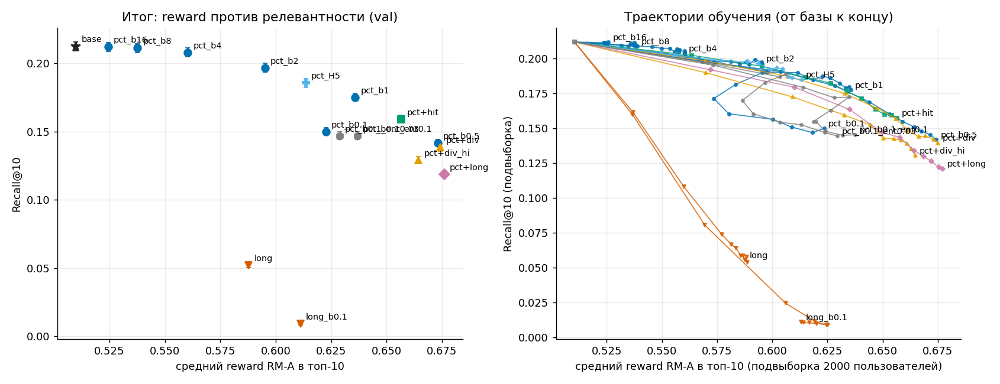
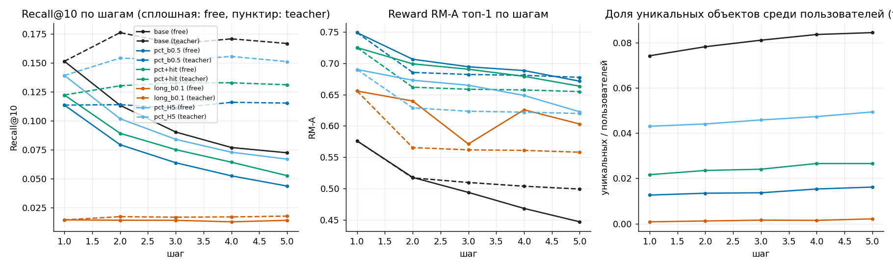
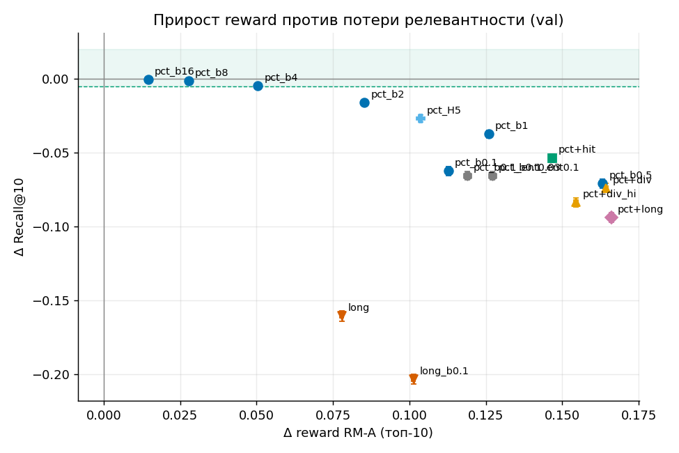

# recsys-rl-finetuning

RL-дообучение последовательной рекомендательной модели (GPT-2) на данных KION (МТС): reward model по доле просмотра, GRPO с KL-штрафом к базовой модели и разбор того, что происходит с рекомендациями. Задача T-Lab №2.

[](https://www.kaggle.com/code/madina404/rl-fine-tuning-of-gpt-2-recommender-on-kion)
[](https://nbviewer.org/github/404iq/recsys-rl-finetuning/blob/main/solution.ipynb)


Всё исследование – в одном ноутбуке [solution.ipynb](solution.ipynb): выполнен на Kaggle (GPU T4, 137 минут), выводы ячеек сохранены. Лёгкие результаты лежат в [results/](results/).

## Содержание

- [Коротко](#коротко)
- [Данные и протокол](#данные-и-протокол)
- [Модели](#модели)
- [Результаты](#результаты)
- [Собственные идеи](#собственные-идеи)
- [Ограничения](#ограничения)
- [Дальнейшая работа](#дальнейшая-работа)
- [Связанные работы](#связанные-работы)
- [Структура репозитория](#структура-репозитория)
- [Воспроизведение](#воспроизведение)

## Коротко



- **База.** GPT-2 лучше сильного бейзлайна «популярное за 7 дней»: Recall@10 0.212 против 0.196 на val (+0.017 [+0.014, +0.020]).
- **Reward model** с известными откликами пользователя предсказывает досмотр ≥50% с AUC 0.745 на val и 0.737 на test (среднее по объекту: 0.672 и 0.659).
- **RL повышает reward, но платит релевантностью.** До β=4 почти бесплатно: reward +0.050, Recall@10 −0.005 (−2%). При β=0.5 reward +0.163, Recall@10 0.212 → 0.142, модель рекомендует всем короткие хиты (длительность 391 → 156 мин, покрытие 0.243 → 0.082).
- **Рост reward в основном реален:** около 80% прироста по RM подтверждается фактическим досмотром рекомендованных объектов в логах, но разрыв «RM минус факт» растёт с силой оптимизации.
- **Долгосрочная награда** «вернулся в течение 3 дней» приводит к эксплуатации: Recall@10 0.009, всем рекомендуются около 10 фильмов серии Marvel.
- **5 шагов вперёд:** цепочка из собственных рекомендаций к 5-му шагу вдвое теряет в релевантности (Recall@10 0.152 → 0.072), а при реальном продолжении нет (0.167).
- **Устойчивость:** разброс между seed (sd Recall@10 0.0003–0.0010) в 6–22 раза меньше ДИ по пользователям; повторный запуск всего ноутбука на Kaggle воспроизвёл все числа.

## Данные и протокол

KION: 5.48 млн взаимодействий, 962 тыс. пользователей, 15.7 тыс. объектов, 2021-03-13 … 2021-08-22. Отклик – `watched_pct`. После фильтра (≥5 событий в train) остаётся 240 тыс. пользователей и 14.9 тыс. объектов.

- **Разбиение строго по времени:** train до 2021-08-02, val 08-02…08-08, test 08-09…08-22. Словарь объектов – только из train. Для test контекст – всё, что было до начала test (train + val). Проверки на утечки встроены в ноутбук.
- **Eval-кейс:** пользователь, цель – его первое событие в периоде, контекст – последние 50 событий до периода. Val 58 173 кейса, test 74 148.
- **Одинаковый протокол** для бейзлайнов, базовой и RL-моделей: ранжируется весь каталог без уже просмотренного. Метрики: Recall@K (= HitRate), NDCG@K, MAP@K (= MRR@K), покрытие, Gini, популярность. Доверительные интервалы 95% – бутстреп по пользователям (1000 повторов), разности – парный бутстреп.
- Test открывался один раз в конце, ничего по нему не подбиралось.

## Модели

- **База:** GPT-2 с нуля (4 слоя, 256, 7.0 млн параметров), next item prediction, окна по 50 объектов, 6 эпох.
- **Reward model (RM-A):** каузальный GPT-2 над объектами и прошлыми откликами пользователя, голова предсказывает `watched_pct` кандидата. У 50% окон при обучении отклики скрыты, чтобы RM работала и на сгенерированных последовательностях.
- **RL:** GRPO (REINFORCE с групповым baseline) + точный KL(π‖π_ref) по всему каталогу. 250 шагов, lr 3e-5, 128 контекстов × 8 траекторий на шаг. Просмотренное маскируется.
- **Награды:** `pct` (RM-A), `pct+hit` (+0.5 за совпадение с реальным следующим объектом), `pct+div` (штраф η·ln c за скопление одного объекта в батче, η = 0.01 и 0.05), `long` (RM-ret, вероятность вернуться за 3 дня), `pct+long`. Сетка β = 0.1, 0.5, 1, 2, 4, 8, 16 для `pct`, остальные при β=0.5 (`long` ещё и при 0.1). Дополнительно: горизонт 5 шагов (`pct_H5`), бонус за энтропию при β=0.1, повторы с 3 seed для β=2, β=8 и `pct+hit`.
- **Дополнительные RM:** RM-B (1 слой, другой seed) как проверка и RM-ret для долгосрочной цели.

## Результаты

### Базовая модель (val)

| | Recall@10 | NDCG@10 | покрытие@10 |
|---|---|---|---|
| Популярное, всё время | 0.140 | 0.083 | 0.003 |
| Популярное, последние 7 дней | 0.196 | 0.102 | 0.002 |
| **GPT-2** | **0.212** [0.209, 0.216] | **0.126** | 0.243 |

### Reward model

| | RMSE, val | AUC, val | RMSE, test | AUC, test |
|---|---|---|---|---|
| Константа | 40.2 | 0.500 | 40.2 | 0.500 |
| Среднее по объекту | 37.7 | 0.672 | 38.3 | 0.659 |
| Объект + пользователь | 36.9 | 0.720 | 37.6 | 0.709 |
| RM, отклики контекста скрыты | 37.3 | 0.683 | 38.0 | 0.667 |
| **RM, отклики известны** | **35.2** | **0.745** [0.743, 0.749] | **35.6** | **0.737** [0.734, 0.739] |

AUC – для события «досмотрел ≥50%». Основной сигнал – прошлый досмотр пользователя: без откликов RM почти не лучше среднего по объекту. Калибровка завышена на 5–6 п.п. из-за сдвига во времени (средний досмотр 51.1 в train, 44.4 в val); для RL это не критично, потому что преимущество считается внутри группы.

### RL: reward против релевантности (val)

| | Recall@10 | NDCG@10 | reward RM-A | факт. досмотр, % | длит., мин | покрытие | перекрытие с базой |
|---|---|---|---|---|---|---|---|
| база | 0.212 [0.209, 0.216] | 0.126 | 0.510 | 46.7 | 391 | 0.243 | 1.00 |
| pct, β=16 | 0.212 [0.209, 0.215] | 0.125 | 0.525 | 47.9 | 343 | 0.239 | 0.95 |
| pct, β=8 | 0.211 [0.208, 0.214] | 0.124 | 0.538 | 49.0 | 303 | 0.237 | 0.92 |
| pct, β=4 | 0.208 [0.205, 0.211] | 0.121 | 0.560 | 50.9 | 252 | 0.233 | 0.85 |
| pct, β=2 | 0.197 [0.193, 0.200] | 0.113 | 0.595 | 53.8 | 206 | 0.222 | 0.74 |
| pct, β=1 | 0.175 [0.172, 0.178] | 0.098 | 0.636 | 57.1 | 168 | 0.177 | 0.58 |
| pct, β=0.5 | 0.142 [0.139, 0.144] | 0.078 | 0.673 | 59.5 | 156 | 0.082 | 0.39 |
| pct, β=0.1 | 0.150 [0.147, 0.153] | 0.077 | 0.623 | 54.9 | 213 | 0.015 | 0.39 |
| pct, β=0.1 + энтропия 0.1 | 0.147 [0.144, 0.150] | 0.075 | 0.637 | 55.8 | 200 | 0.018 | 0.39 |
| pct+hit | 0.159 [0.156, 0.162] | 0.091 | 0.657 | 58.6 | 160 | 0.122 | 0.48 |
| pct+div (η=0.01) | 0.138 [0.136, 0.141] | 0.077 | 0.674 | 59.8 | 149 | 0.087 | 0.39 |
| pct+div (η=0.05) | 0.129 [0.126, 0.132] | 0.074 | 0.664 | 59.7 | 132 | 0.129 | 0.39 |
| long, β=0.5 | 0.052 [0.050, 0.054] | 0.027 | 0.588 | 54.7 | 145 | 0.234 | 0.16 |
| long, β=0.1 | 0.009 [0.008, 0.010] | 0.004 | 0.611 | 58.9 | 128 | 0.006 | 0.02 |
| pct+long | 0.119 [0.116, 0.121] | 0.065 | 0.676 | 59.9 | 134 | 0.091 | 0.32 |
| pct_H5 | 0.186 [0.183, 0.189] | 0.106 | 0.614 | 55.1 | 198 | 0.189 | 0.65 |

«Факт. досмотр» – средний `watched_pct` рекомендованных объектов по событиям val (RM его не видела). Разности с базой и их ДИ – в разделе 5.2 ноутбука и в [rl_delta_full_s250_lr3e-05.json](results/rl_delta_full_s250_lr3e-05.json).

### Как изменилось поведение и почему

- **Короткие хиты.** Длительность топ-10 падает с 391 до 156 мин (β=0.5), доля сериалов с 0.30 до 0.09, средний досмотр рекомендованных объектов в train с 51% до 68%. RM в основном выучила эффект объекта (среднее по объекту уже даёт AUC 0.672), поэтому политика находит объекты с высокой долей досмотра.
- **Потеря персонализации.** При β=0.5 покрытие 0.082, 97% слотов приходится на 100 объектов (у базы 73%). Потеря Recall одинакова по группам: −31% / −34% / −38% для истории 5–9 / 10–24 / ≥25 и −32% / −35% / −33% по вовлечённости.
- **Не артефакт метрики.** По 6 следующим событиям (цель и 5 следующих) относительная потеря та же: при β=0.5 0.658 от базы против 0.666 по одному событию.
- **Схлопывание при слабом KL.** При β=0.1 энтропия политики 0.06, около 220 объектов на весь каталог. Бонус за энтропию (0.03 и 0.1) этого не исправляет: преимущество нормировано на единичное отклонение, и сигнал policy gradient на порядки сильнее энтропийного слагаемого.
- **Знакомый контент не растёт.** Повторов в KION нет, поэтому знакомость измерена по жанрам. База рекомендует жанры из истории чаще, чем пользователи их смотрят (косинус жанров с историей 0.506 против 0.478 у реального следующего объекта). Слабый RL этого не меняет, сильный сдвигает к реальности (β=0.5: 0.471), схлопнувшиеся политики уходят от истории (β=0.1: 0.411).

### Это reward hacking или реальный эффект

RM-B повторяет RM-A (корреляция предсказаний 0.985), поэтому как независимый судья не годится. Независимая проверка – фактический досмотр рекомендованных объектов в логах val:

| | Δ RM-A, п.п. | Δ факт. досмотр, п.п. | подтверждено | RM-A минус факт, п.п. |
|---|---|---|---|---|
| база | – | – | – | 4.3 |
| β=8 | +2.8 | +2.3 | 83% | 4.8 |
| β=4 | +5.0 | +4.2 | 83% | 5.1 |
| β=2 | +8.5 | +7.1 | 83% | 5.7 |
| β=0.5 | +16.3 | +12.8 | 78% | 7.8 |
| β=0.1 | +11.3 | +8.2 | 73% | 7.3 |

Большая часть прироста реальна: выбранные объекты действительно досматривают лучше. Но чем сильнее оптимизация, тем меньше подтверждённая доля и тем сильнее RM завышает выбранные объекты, то есть часть прироста – эксплуатация ошибок RM. Оговорка: факт – среднее по объекту, а не персональный исход.

### Долгосрочная цель

Сигнал: пользователь вернулся (новое событие в другой день) в течение 3 дней; лайков и сессий в данных нет, только даты. RM-ret предсказывает возврат с AUC 0.684 [0.679, 0.689]; среднее по пользователю даёт 0.649, среднее по объекту 0.567. Объект влияет на возврат слабее, чем пользователь.

Оптимизация по этой награде эксплуатирует именно это: Recall@10 падает до 0.052 (β=0.5) и 0.009 (β=0.1), при β=0.1 каждому рекомендуются те же около 10 фильмов Marvel (по 9.8% слотов). Фактический возврат этих объектов в val высок (0.72 против 0.52 у базы), но это эффект отбора: их смотрят активные пользователи. Влияние рекомендации на возврат так не доказать.

Офлайн проверяются релевантность, поведение, reward по RM и фактические исходы по логам. Причинный эффект на возврат и удовлетворённость требует онлайн-эксперимента (A/B) или офлайн-оценки по пропенсити логирующей политики, которых в KION нет.

### Несколько шагов вперёд



На 10 761 пользователе с ≥5 событиями в периоде: топ-1 добавляется в контекст (free) либо добавляется реальное событие (teacher).

| Recall@10 | шаг 1 | шаг 5, free | шаг 5, teacher |
|---|---|---|---|
| база | 0.152 | 0.072 | 0.167 |
| pct, β=0.5 | 0.114 | 0.044 | 0.115 |
| pct_H5 | 0.139 | 0.067 | 0.151 |

К 5-му шагу релевантность free-цепочки вдвое ниже, при реальном продолжении не падает. Reward RM-A у free-цепочки базы падает с 0.576 до 0.447 (teacher 0.499); RM не видела контекстов из сгенерированных объектов, поэтому отделить «объекты хуже» от «RM смещена» нельзя. Доля уникальных топ-1 среди пользователей: 0.074 у базы, 0.013 у β=0.5, 0.001 у `long` β=0.1.

### Компромисс и test



Прирост RM-A на 0.01 потери Recall@10: 0.73 (β=16), 0.23 (β=8), 0.11 (β=4), 0.054 (β=2), 0.034 (β=1), 0.023 (β=0.5). Среди наград при β=0.5: горизонт 5 – 0.039, бонус `hit` – 0.028, чистая `pct` – 0.023, штраф за скопление – 0.022, смесь с долгосрочной – 0.018, `long` – 0.005.

Test (одинаковый протокол):

| | Recall@10 | NDCG@10 | reward RM-A |
|---|---|---|---|
| база | 0.196 [0.194, 0.199] | 0.116 | 0.506 |
| Популярное, 7 дней | 0.184 [0.181, 0.187] | 0.099 | 0.454 |
| pct, β=16 | 0.195 [0.192, 0.198] | 0.115 | 0.520 |
| pct, β=8 | 0.194 [0.191, 0.196] | 0.114 | 0.534 |
| pct, β=4 | 0.190 [0.187, 0.193] | 0.111 | 0.556 |
| pct, β=2 | 0.180 [0.177, 0.182] | 0.104 | 0.591 |
| pct, β=1 | 0.159 [0.157, 0.162] | 0.093 | 0.633 |
| pct, β=0.5 | 0.133 [0.131, 0.136] | 0.075 | 0.671 |
| pct+hit | 0.146 [0.144, 0.149] | 0.086 | 0.654 |
| pct_H5 | 0.172 [0.169, 0.174] | 0.100 | 0.610 |
| long, β=0.1 | 0.008 [0.007, 0.009] | 0.003 | 0.608 |

Порядок моделей тот же, что на val. На test потеря у β=4 чуть больше (−0.006, −3%), граница допустимого проходит между β=4 и β=8. Ни один RL-вариант не превосходит базу по Recall и NDCG.

### Разброс между запусками

| | Recall@10, среднее по 3 seed | sd | ширина ДИ по пользователям | reward RM-A, sd |
|---|---|---|---|---|
| pct, β=2 | 0.196 | 0.0010 | 0.0065 | 0.0009 |
| pct, β=8 | 0.211 | 0.0003 | 0.0066 | 0.0007 |
| pct+hit | 0.158 | 0.0009 | 0.0057 | 0.0010 |

## Собственные идеи

- **RM с токеном «отклик неизвестен».** Половина окон при обучении – со скрытыми откликами, поэтому одна RM оценивает и реальную историю, и сгенерированную. Это же показало, что основной сигнал в доле просмотра – вовлечённость пользователя, а не набор объектов.
- **Точный KL по всему каталогу** вместо оценки по сэмплу: каталог в 15 тыс. объектов это позволяет, и шум градиента KL пропадает.
- **Штраф за скопление** одного объекта в батче (η·ln c) как прямая мера «всем одно и то же» внутри функции награды.
- **Бонус за совпадение с реальным следующим объектом:** гибрид RL-награды и логированного сигнала как якорь релевантности.
- **Проверка reward hacking без RM:** фактический досмотр рекомендованных объектов в логах и доля прироста reward, подтверждённая фактом.
- **Режимы free и teacher** для генерации на несколько шагов: отделяют эффект собственных рекомендаций в контексте от естественного дрейфа.
- **Знакомость через жанры** при отсутствии повторных просмотров в данных.

## Ограничения

- Повторы по seed есть только для трёх конфигураций (разброс мал), остальные – по одному запуску.
- Релевантность считается по реальным событиям (одно следующее или 6 следующих): для рекомендованных, но не просмотренных объектов исход неизвестен.
- В KION только дата без времени, нет лайков и длительности объектов (длительность оценена по `total_dur` и доле досмотра).
- RM-B почти копия RM-A, независимой награды нет; фактический досмотр – среднее по объекту, не персональный исход.
- Повторных просмотров в данных нет, повторные рекомендации напрямую не исследованы.
- Многошаговая оценка сделана на пользователях с ≥5 событиями в периоде (смещение к активным).
- Всё офлайн, влияние на реальное поведение не измерялось.

## Дальнейшая работа

- Адаптивный β с целевым KL вместо фиксированного, чтобы держаться у границы β≈4–8.
- Ограниченная оптимизация: максимум reward при Recall ≥ база − ε (множитель Лагранжа).
- Явное ограничение энтропии против схлопывания.
- Причинная оценка долгосрочной награды (онлайн A/B или офлайн-оценка по пропенсити).
- Обучение RM на контекстах из сгенерированных объектов.

## Связанные работы

- Kang, McAuley. [Self-Attentive Sequential Recommendation](https://arxiv.org/abs/1808.09781) (2018) – трансформер для next item prediction.
- Chen et al. [Top-K Off-Policy Correction for a REINFORCE Recommender System](https://arxiv.org/abs/1812.02353) (2019) – REINFORCE для рекомендаций.
- Ziegler et al. [Fine-Tuning Language Models from Human Preferences](https://arxiv.org/abs/1909.08593) (2019) и Ouyang et al. [Training language models to follow instructions with human feedback](https://arxiv.org/abs/2203.02155) (2022) – RL по reward model с KL-штрафом.
- Shao et al. [DeepSeekMath](https://arxiv.org/abs/2402.03300) (2024) – GRPO.
- Gao, Schulman, Hilton. [Scaling Laws for Reward Model Overoptimization](https://arxiv.org/abs/2210.10760) (2023) – рост разрыва между proxy-reward и реальной целью при сильной оптимизации; похожий эффект виден здесь.

## Структура репозитория

```
├── solution.ipynb      # всё исследование, выполненный ноутбук с выводами
├── results/            # метрики, логи, таблицы и рисунки полного прогона (описание в results/README.md)
├── requirements.txt    # версии библиотек для локального запуска
└── README.md
```

## Воспроизведение

Ноутбук рассчитан на Kaggle (GPU T4 или P100): режим выбирается автоматически (на Kaggle полный прогон, локально малая выборка на CPU).

1. Загрузить `interactions.csv`, `items.csv`, `users.csv` (KION) как приватный Kaggle Dataset.
2. Создать ноутбук, импортировать `solution.ipynb`, подключить датасет, включить GPU. Либо открыть [ноутбук на Kaggle](https://www.kaggle.com/code/madina404/rl-fine-tuning-of-gpt-2-recommender-on-kion) и нажать **Copy & Edit**.
3. **Save Version → Save & Run All (Commit)**: полный запуск занимает около 2 ч 20 мин на T4, держать окно браузера открытым не нужно.
4. Лёгкие результаты (`results/*.json`, `*.csv`, `*.png`) скачиваются из Output версии. Чекпойнты и кэш (`checkpoints/`, `cache/`) в репозиторий не входят.

Локально ноутбук работает на малой выборке 30 тыс. пользователей и нужен для проверки кода; полный прогон на CPU не рассчитан. Установка: `pip install -r requirements.txt`. Путь к папке с данными задаётся переменной окружения `DATA_DIR` перед запуском Jupyter, например в PowerShell: `$env:DATA_DIR = "D:\data\kion"`.
